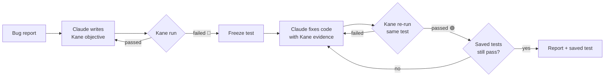

# repro-fix

**Your coding agent has to prove the bug in a real browser before it's allowed to fix it.**

Coding agents love to say *"Fixed! ✅"*. repro-fix doesn't take their word for it. Hand it a bug report in plain English and it will:

1. 🧠 **Write a test.** Claude Code reads your app and writes a plain-English [Kane CLI](https://www.testmuai.com/kane-cli/) objective that should pass once the bug is fixed.
2. 🔴 **Reproduce.** Kane runs that test in a real Chrome browser. It must **fail**. If it passes, the bug isn't reproduced and no code is touched.
3. 🔒 **Freeze.** The failing test is locked. The fixer can't edit it to make it easier to pass.
4. 🔧 **Fix.** Claude Code gets the bug plus Kane's evidence (what it saw, why it failed, the final page state) and edits the code.
5. 🟢 **Verify.** Kane re-runs the *exact same* test. If it still fails, the new failure goes back to the fixer (up to 3 attempts).
6. 🛡️ **Regression.** Every previously fixed bug's test runs again. If the fix broke one, that failure goes back to the fixer too.
7. 📄 **Record.** The test is saved to `.repro/tests/` and a report lands in `.repro/reports/` with the red run, the diff, the green run and Kane links.



Kane's results are fed back into the agent loop at every step. That loop is the product.

## Demo

`demo/brightcart` is a small shop with four planted bugs (expired coupon accepted, case-sensitive search, quantity going negative, free-shipping threshold off by one). Real runs from building this repo (3 bugs, all red → green, with regression checks) are committed in [`docs/example-runs`](docs/example-runs). The demo on `main` stays buggy so you can run it yourself.

**Try the buggy shop live:** https://brightcart-demo.vercel.app (try coupon `FALL10`, search "mug", or press − until the quantity hits 0). It's a static deploy of the buggy version and is never fixed, so it's the "before" picture. repro-fix itself runs against your local copy.

```
🐞 Expired coupon FALL10 is still accepted at checkout — it should be rejected
🌐 http://localhost:5173

🧠 Writing a Kane test that reproduces the bug
🧪 Running: On the Brightcart page, click "Add to cart" on the Stoneware Mug, type FALL10 into the
   "Coupon code" field, and click "Apply". Verify that the message "This coupon has expired" is shown...
🔴 Reproduced: Applying FALL10 gives a coupon-applied message and a $1.60 discount instead of
   reporting that the coupon has expired.
🔧 Fix attempt 1/3
🧪 Re-running the frozen test
🟢 Frozen test passes

🟢 Verified — reproduced, fixed, re-tested green
📄 Report: .repro/reports/20261124-1216-expired-coupon-fall10-is-still-accepted-at.md · Kane credits: 41.3
```

## Requirements

- Node 20+
- [Kane CLI](https://www.testmuai.com/kane-cli/), logged in: `npm i -g @testmuai/kane-cli && kane-cli login --oauth`
- [Claude Code](https://claude.com/claude-code), logged in. repro-fix runs it headless (`claude -p`), so **no API key is needed**. It uses your normal Claude Code login.
- Chrome

## Quick start

```bash
git clone https://github.com/David07-ade/repro-fix && cd repro-fix
npm install            # also builds
npm link               # puts `repro-fix` on your PATH

cd demo/brightcart && npm install
repro-fix "Searching for 'mug' in lowercase shows 'No products found'" --no-commit
```

`demo/brightcart/repro.config.json` tells repro-fix where the app lives and how to start it:

```json
{ "url": "http://localhost:5173", "start": "npm run dev" }
```

## Usage

```
repro-fix "<bug report>"      reproduce → fix → verify
repro-fix --issue bug.md       read the bug report from a file
repro-fix test                 re-run every saved test (your regression suite)

--url <url>       app URL (default: repro.config.json "url")
--model <alias>   Claude model (default: sonnet)
--no-commit       don't commit the verified fix on a repro-fix/<slug> branch
```

Exit code is `0` only when the bug was reproduced **and** the fix was verified, so it can gate CI.

## Guardrails

- **No fix without a red run.** If Kane can't make the test fail, repro-fix stops with "not reproduced" and changes nothing.
- **Frozen tests.** The green run uses the identical objective string as the red run.
- **Saved tests and config are off-limits.** The fixer runs with `--disallowedTools` rules for `.repro/**` and `repro.config.json`, and repro-fix fingerprints both before and after every fix. Any change aborts the run as `tampered`.
- **Errors still leave a report.** If Claude or Kane fails mid-run, you get a report with every run so far, the credits used and the files already changed.
- **Infra errors aren't bugs.** Kane exit codes other than 0/1, or a missing `run_end`, count as infrastructure errors. They're retried once and never treated as a reproduction.
- **Your work is safe.** It commits only if your tree was clean before the run, on its own `repro-fix/<slug>` branch. It never pushes.

**Known limit:** the fixer could, in theory, special-case the app so it fools the test (for example by always rendering the expected message). The prompt forbids it and the diff is in every report for review, but that check is a human one.

## How Kane results feed the agent

repro-fix runs `kane-cli run "<objective>" --url <url> --agent --headless` and reads the final NDJSON `run_end` event. These fields go straight into the fixer's prompt:

| Kane field | Used for |
|---|---|
| `status` + exit code | pass / fail / infra error |
| `one_liner`, `summary` | what Kane saw, in words |
| `reason` | which check failed and why |
| `final_state` | values Kane extracted from the page |
| `test_url` | Test Manager evidence link in the report |
| `credits_consumed` | cost tracking |

## Troubleshooting (Windows)

If `kane-cli run` exits with code 2 and `~/.testmuai/kaneai/sessions/<id>/tui.log` says `v16-runner not found`, npm skipped Kane's Windows runner add-on. Install it into the global kane-cli folder:

```bash
cd "$(npm root -g)/@testmuai/kane-cli"
npm install --no-save @testmuai/kane-cli-win-x64@$(kane-cli --version)
```

## Development

```bash
npm test                          # 50+ unit tests; the loop is tested with fake Kane/Claude
npx tsx scripts/kane-once.ts "<objective>" http://localhost:5173   # one real Kane run
```

Built for the TestMu AI Kane CLI hackathon (Nov 2026) with Claude Code.

## License

MIT
